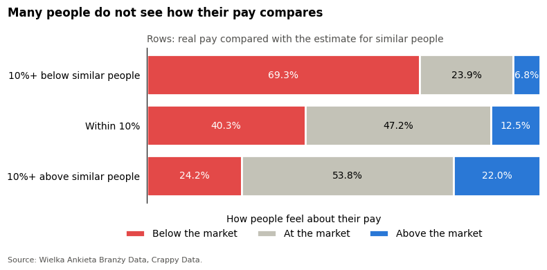
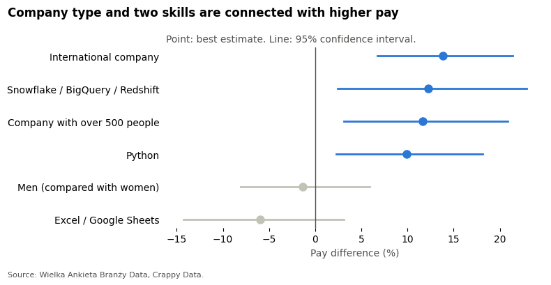

# What Are You Worth? Pay in Data Jobs

**Do you know if you are paid fairly?** In a survey of data professionals, 45% of people feel that they earn below the market, and only 14% feel that they earn above it. This project checks which things are really connected with higher pay, and whether people know their market value.

**[Open the full analysis](pay_in_data_jobs_en.ipynb)**



## The story in four steps

1. **Which factors are connected with pay?** Statistical tests (Kruskal-Wallis, effect sizes, Holm correction).
2. **What stays when we compare similar people?** Linear regression on log pay, with checks of the assumptions and of the results.
3. **How well can we predict pay?** Machine learning: Ridge, Lasso, decision tree, Random Forest, XGBoost and LightGBM, compared with cross-validation.
4. **Do people know their market value?** A model estimates the pay of similar people, and we compare it with real pay and with each person's feeling.

## Main results

- **Seniority and contract type matter most.** Tests, regression and machine learning all agree.
- **The employer matters.** International companies pay about 12-14% more than similar people get in Polish companies.
- **Python is connected with higher pay.** People who use it earn about 10-12% more than similar people. This is a connection, not a proven cause.
- **No clear difference** for field of education or gender among similar people.
- **Pay can be predicted only partly.** The best models reach R² of about 0.5 with a typical error of about 23%. Tuned boosting was the most accurate, but simple linear models were close. Default XGBoost overfitted strongly.
- **Many people do not see their position.** Of people who earn at least 10% more than similar people, only 22% feel that they earn above the market, and 24% still feel that they earn below it.



## Data

The data comes from **Wielka Ankieta Branży Data** (Great Data Industry Survey) by **Crappy Data**. It has 297 people who work with data. The analysis uses 264 of them.

**Pay** means average monthly take-home pay ("na rękę") in PLN. People were expected to divide their yearly income by 12, after all taxes and social contributions (ZUS).

**The raw data is not in this repository**, because the data rules do not allow publishing it. The notebook shows only group results and hides groups with fewer than 5 people.

## Project structure

```text
pay-in-data-jobs-en/
├── pay_in_data_jobs_en.ipynb    Full analysis with results
├── images/                      Charts used in this README
├── requirements.txt             Python packages
└── README.md
```

## How to run it

You can read the notebook and all its results on GitHub without running anything.

To run it again, you need your own access to the survey data. Put the CSV files in a `data` folder next to the project folder:

```text
your-folder/
├── data/                        Survey CSV files (not in this repository)
└── pay-in-data-jobs-en/
```

Then install the packages and open the notebook:

```bash
pip install -r requirements.txt
jupyter notebook pay_in_data_jobs_en.ipynb
```

The model comparison takes a few minutes.

## Source

Źródło: Wielka Ankieta Branży Data, Crappy Data.
